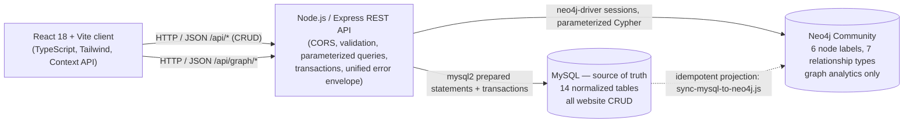

# TransitFlow — Public Bus & Metro Transit Management System

A production-grade, responsive Full-Stack Transit Operations Management System built for **Public Bus and Metro Networks**. 

TransitFlow integrates a high-performance **React 18 + TypeScript** client with an enterprise **Relational SQL Database (MySQL)** via a **Node.js / Express REST API** service layer. It models complex transit relationships including multi-valued phone contacts, M:N route-station topologies, weak-entity trip progress schedules, 1:1 vehicle-driver assignments, and seat collision safeguards.

MySQL remains the **source of truth** for every screen. An **optional Neo4j graph projection**, refreshed by an idempotent sync script, serves multi-hop network analytics (route traces, weighted pathfinding, passenger journeys) that the relational model can only reach through recursive joins. The two engines are complementary: the graph layer is additive, and the application degrades to `503` on graph routes — with CRUD unaffected — whenever Neo4j is offline.

---

## 📑 Table of Contents

- [System Architecture](#-system-architecture)
- [SQL & Frontend Connection Flow](#-sql--frontend-connection-flow)
- [Directory Structure & Updated Files Breakdown](#-directory-structure--updated-files-breakdown)
- [Relational Database Schema (SQL DDL)](#-relational-database-schema-sql-ddl)
- [TypeScript Interface vs SQL Schema Mapping](#-typescript-interface-vs-sql-schema-mapping)
- [Connecting SQL with the Frontend (Code Walkthrough)](#-connecting-sql-with-the-frontend-code-walkthrough)
  - [1. Backend SQL Connection Pool (`db.js`)](#1-backend-sql-connection-pool-dbjs)
  - [2. REST API Controller (`server.js`)](#2-rest-api-controller-serverjs)
  - [3. Frontend API Client (`src/services/api.ts`)](#3-frontend-api-client-srcservicesapits)
  - [4. Reactive State Integration (`TransitContext.tsx`)](#4-reactive-state-integration-transitcontexttsx)
- [Environment Configuration (`.env`)](#-environment-configuration-env)
- [Step-by-Step Installation & Run Guide](#-step-by-step-installation--run-guide)
- [Core Functional Modules](#-core-functional-modules)
- [REST API Reference](#-rest-api-reference)
- [How to Test](#-how-to-test)
- [Relational Integrity & Business Logic](#-relational-integrity--business-logic)
- [Graph Database Report (Neo4j justification, schema, Cypher, benchmarks)](docs/GRAPH_DATABASE_JUSTIFICATION.md)
- [License](#-license)

---

## 🏛️ System Architecture

TransitFlow employs a decoupled architecture with one write path (MySQL) and one analytical
read path (Neo4j):



The same topology as a tier stack:

```
┌─────────────────────────────────────────────────────────────┐
│                    React 18 + Vite Client                   │
│   (TypeScript, Tailwind CSS, Lucide Icons, Context API)     │
└──────────────────────────────┬──────────────────────────────┘
                               │ HTTP / JSON (REST API)
                               ▼
┌─────────────────────────────────────────────────────────────┐
│                   Node.js / Express API                     │
│  (CORS, request validation, pooling, transactions, errors)  │
└──────────┬───────────────────────────────────────┬──────────┘
           │ TCP / prepared SQL                    │ Bolt / parameterized Cypher
           ▼                                       ▼
┌──────────────────────────────┐    ┌──────────────────────────┐
│   Relational Database        │    │  Graph Database          │
│   MySQL — 14 tables          │───▶│  Neo4j Community         │
│   source of truth for CRUD   │sync│  route/path/booking      │
│                              │    │  analytics               │
└──────────────────────────────┘    └──────────────────────────┘
```

---

## 🔌 SQL & Frontend Connection Flow

The link between the React user interface and the SQL database follows a transactional request-response pipeline:

```
[ User Interaction ] 
        │ (e.g. Submits "Add Passenger" form)
        ▼
[ Form Validation ] ─── Regex check (Email, PIN, Phone numbers)
        │
        ▼
[ TransitContext.tsx ] ─ Calls asynchronous action dispatch
        │
        ▼
[ api.ts Service Layer ] ── Sends HTTP POST /api/passengers with JSON payload
        │
        ▼
[ Express Router & Controller ] ── Extracts req.body & runs SQL Transaction:
        ├── 1. INSERT INTO passengers (passenger_id, first_name, last_name, ...)
        └── 2. INSERT INTO passenger_contacts (passenger_id, phone_number) [for each phone]
        │
        ▼
[ SQL Database Engine ] ── Executes ACID transaction & returns auto-generated records / status
        │
        ▼
[ HTTP 201 Created ] ── Returns created Passenger object with contacts
        │
        ▼
[ TransitContext State Update ] ── Updates UI state immutably & triggers Toast notification
        │
        ▼
[ Re-rendered UI View ] ── Displays updated data table instantly with zero page reload
```

---

## 🗂️ Directory Structure & Updated Files Breakdown

Below is the complete overview of the updated codebase files, categorized by subsystem:

```
transit-management-system/
├── database/
│   └── schema.sql                           # 14-table relational DDL + demo seed data
│
├── docs/
│   └── GRAPH_DATABASE_JUSTIFICATION.md      # Academic report: MySQL vs Neo4j, what is tested
│
├── backend/                                 # Express API service (ESM)
│   ├── config/
│   │   ├── db.js                            # mysql2/promise pool (dateStrings, decimalNumbers)
│   │   └── neo4j.js                         # [NEW] singleton driver, runCypher / runCypherTransaction
│   ├── controllers/
│   │   ├── resourceController.js            # Generic CRUD handlers over the resource registry
│   │   ├── compositeController.js           # Multi-table, transactional endpoints (trip + stops, checkout)
│   │   └── neo4jTransitController.js        # [NEW] Features A/B/C + graph health, sync, booking demo
│   ├── database/
│   │   ├── sync-mysql-to-neo4j.js           # [NEW] idempotent CLI projection, prunes deleted rows
│   │   └── neo4j_seed.cypher                # Earlier hand-written seed (superseded by the sync; kept)
│   ├── middleware/
│   │   └── errorHandler.js                  # 404 + unified error envelope
│   ├── models/
│   │   └── resourceRegistry.js              # Declarative table/column/FK/reference metadata
│   ├── routes/
│   │   ├── resourceRoutes.js                # MySQL CRUD routes
│   │   └── neo4jRoutes.js                   # [NEW] /api/graph/* routes
│   ├── services/
│   │   ├── resourceService.js               # Parameterized CRUD, transactions, delete guards
│   │   ├── compositeService.js              # Atomic trip scheduling + booking checkout
│   │   └── graphSyncService.js              # [NEW] snapshot → MERGE → prune-stale
│   ├── utils/
│   │   ├── fields.js                        # Row ↔ DTO mapping helpers
│   │   └── http.js                          # ApiError, MySQL + Neo4j error mapping
│   ├── .env.example                         # Credential template (real .env is gitignored)
│   ├── package.json                         # express, mysql2, cors, dotenv, neo4j-driver
│   └── server.js                            # Entry point, /api/health, graceful shutdown
│
├── src/                                     # Frontend client (React 18 + TypeScript)
│   ├── components/
│   │   ├── common/                          # Badge, ConfirmDialog, DataTable, Modal, MultiInput, Toast
│   │   ├── layout/
│   │   │   ├── Header.tsx                   # Per-tab title/description + global search
│   │   │   └── Sidebar.tsx                  # Navigation, including the Graph Explorer entry
│   │   └── modules/
│   │       ├── dashboard/ · passengers/ · routes/ · fleet/ · trips/ · bookings/
│   │       └── graph/
│   │           └── GraphExplorer.tsx         # [NEW] health bar, route trace, weighted path, journeys
│   ├── context/
│   │   └── TransitContext.tsx                # API-backed state layer (loading/busy/error toasts)
│   ├── services/
│   │   └── api.ts                            # HTTP client + graph API types, request timeout
│   ├── types/
│   │   └── transit.ts                        # Strict TypeScript models mirroring the SQL schema
│   ├── App.tsx                               # Sidebar routing, API status strip, toast container
│   ├── index.css · main.tsx · vite-env.d.ts
│
├── .env.example                             # VITE_API_BASE_URL
├── index.html · package.json · postcss.config.js · tailwind.config.js
└── tsconfig.json · vite.config.ts            # Strict TS (noUnusedLocals/Parameters) + Vite 5
```

---

## 🗄️ Relational Database Schema (SQL DDL)

Here is the complete MySQL DDL schema defining all 14 normalized database tables, primary keys, foreign keys, and referential constraints (authoritative copy: [`database/schema.sql`](database/schema.sql), which also carries the demo seed data):

```sql
-- =================================================================
-- TRANSITFLOW RELATIONAL DATABASE SCHEMA (MySQL 8.0+ / MariaDB)
-- =================================================================

DROP DATABASE IF EXISTS transit_management;
CREATE DATABASE transit_management;
USE transit_management;

-- 1. PASSENGERS TABLE
CREATE TABLE passengers (
    passenger_id VARCHAR(20) PRIMARY KEY,
    first_name VARCHAR(50) NOT NULL,
    last_name VARCHAR(50) NOT NULL,
    email VARCHAR(100) UNIQUE NOT NULL,
    gender ENUM('F', 'M', 'Other') NOT NULL,
    dob DATE NOT NULL,
    door_no VARCHAR(20),
    street VARCHAR(100),
    city VARCHAR(50) NOT NULL,
    state VARCHAR(50) NOT NULL,
    pin VARCHAR(10) NOT NULL,
    created_at TIMESTAMP DEFAULT CURRENT_TIMESTAMP
);

-- 2. PASSENGER CONTACTS (1:N Multi-Valued Attribute)
CREATE TABLE passenger_contacts (
    passenger_id VARCHAR(20) NOT NULL,
    phone_number VARCHAR(15) NOT NULL,
    PRIMARY KEY (passenger_id, phone_number),
    FOREIGN KEY (passenger_id) REFERENCES passengers(passenger_id) ON DELETE CASCADE
);

-- 3. ROUTES TABLE
CREATE TABLE routes (
    route_id VARCHAR(20) PRIMARY KEY,
    name VARCHAR(100) NOT NULL,
    type ENUM('Bus', 'Metro') NOT NULL,
    total_distance_km DECIMAL(6, 2) NOT NULL,
    created_at TIMESTAMP DEFAULT CURRENT_TIMESTAMP
);

-- 4. STATIONS TABLE
CREATE TABLE stations (
    station_id VARCHAR(20) PRIMARY KEY,
    name VARCHAR(100) NOT NULL,
    city VARCHAR(50) NOT NULL,
    area VARCHAR(50) NOT NULL,
    landmark VARCHAR(100),
    created_at TIMESTAMP DEFAULT CURRENT_TIMESTAMP
);

-- 5. ROUTE_STATIONS (M:N Associative Entity with Sequence Order)
CREATE TABLE route_stations (
    id VARCHAR(50) PRIMARY KEY,
    route_id VARCHAR(20) NOT NULL,
    station_id VARCHAR(20) NOT NULL,
    stop_order INT NOT NULL,
    distance_from_start_km DECIMAL(6, 2) DEFAULT 0.00,
    FOREIGN KEY (route_id) REFERENCES routes(route_id) ON DELETE CASCADE,
    FOREIGN KEY (station_id) REFERENCES stations(station_id) ON DELETE CASCADE,
    UNIQUE KEY uq_route_stop (route_id, stop_order)
);

-- 6. VEHICLE TYPES TABLE
CREATE TABLE vehicle_types (
    type_id VARCHAR(20) PRIMARY KEY,
    name VARCHAR(50) NOT NULL,
    capacity INT NOT NULL,
    fuel_type ENUM('Diesel', 'Electric', 'CNG') NOT NULL
);

-- 7. DRIVERS TABLE
CREATE TABLE drivers (
    driver_id VARCHAR(20) PRIMARY KEY,
    name VARCHAR(100) NOT NULL,
    license_no VARCHAR(50) UNIQUE NOT NULL,
    dob DATE NOT NULL,
    created_at TIMESTAMP DEFAULT CURRENT_TIMESTAMP
);

-- 8. DRIVER CONTACTS (1:N Multi-Valued Attribute)
CREATE TABLE driver_contacts (
    driver_id VARCHAR(20) NOT NULL,
    phone_number VARCHAR(15) NOT NULL,
    PRIMARY KEY (driver_id, phone_number),
    FOREIGN KEY (driver_id) REFERENCES drivers(driver_id) ON DELETE CASCADE
);

-- 9. VEHICLES TABLE (Enforces 1:1 Driver Assignment via UNIQUE KEY)
CREATE TABLE vehicles (
    vehicle_id VARCHAR(20) PRIMARY KEY,
    registration_no VARCHAR(30) UNIQUE NOT NULL,
    manufacture_date DATE NOT NULL,
    color VARCHAR(30) NOT NULL,
    vehicle_type_id VARCHAR(20) NOT NULL,
    assigned_driver_id VARCHAR(20) UNIQUE, -- 1:1 Active Assignment constraint
    FOREIGN KEY (vehicle_type_id) REFERENCES vehicle_types(type_id) ON DELETE RESTRICT,
    FOREIGN KEY (assigned_driver_id) REFERENCES drivers(driver_id) ON DELETE SET NULL
);

-- 10. TRIPS TABLE
CREATE TABLE trips (
    trip_id VARCHAR(20) PRIMARY KEY,
    date DATE NOT NULL,
    start_time TIME NOT NULL,
    end_time TIME NOT NULL,
    route_id VARCHAR(20) NOT NULL,
    FOREIGN KEY (route_id) REFERENCES routes(route_id) ON DELETE CASCADE
);

-- 11. TRIP STOPS (Weak Entity identified by Trip + Stop Order)
CREATE TABLE trip_stops (
    id VARCHAR(50) PRIMARY KEY,
    trip_id VARCHAR(20) NOT NULL,
    station_id VARCHAR(20) NOT NULL,
    stop_order INT NOT NULL,
    arrival_time TIME NOT NULL,
    departure_time TIME NOT NULL,
    status ENUM('Scheduled', 'On Time', 'Delayed', 'Departed') DEFAULT 'Scheduled',
    FOREIGN KEY (trip_id) REFERENCES trips(trip_id) ON DELETE CASCADE,
    FOREIGN KEY (station_id) REFERENCES stations(station_id) ON DELETE CASCADE,
    UNIQUE KEY uq_trip_stop_order (trip_id, stop_order)
);

-- 12. BOOKINGS TABLE (Passenger M:N Trip with Seat Collision Guard)
CREATE TABLE bookings (
    booking_id VARCHAR(20) PRIMARY KEY,
    passenger_id VARCHAR(20) NOT NULL,
    trip_id VARCHAR(20) NOT NULL,
    seat_number VARCHAR(10) NOT NULL,
    date DATE NOT NULL,
    status ENUM('Confirmed', 'Cancelled') DEFAULT 'Confirmed',
    FOREIGN KEY (passenger_id) REFERENCES passengers(passenger_id) ON DELETE CASCADE,
    FOREIGN KEY (trip_id) REFERENCES trips(trip_id) ON DELETE CASCADE,
    UNIQUE KEY uq_trip_seat_date (trip_id, seat_number, date)
);

-- 13. PAYMENTS TABLE
CREATE TABLE payments (
    payment_id VARCHAR(20) PRIMARY KEY,
    mode ENUM('UPI', 'Card', 'Cash') NOT NULL,
    amount DECIMAL(10, 2) NOT NULL,
    date DATE NOT NULL,
    txn_reference_no VARCHAR(50) UNIQUE NOT NULL,
    created_at TIMESTAMP DEFAULT CURRENT_TIMESTAMP
);

-- 14. TICKETS TABLE (Relational linkage between Booking, Trip, and Payment)
CREATE TABLE tickets (
    ticket_id VARCHAR(20) PRIMARY KEY,
    booking_id VARCHAR(20) UNIQUE NOT NULL,
    passenger_id VARCHAR(20) NOT NULL,
    trip_id VARCHAR(20) NOT NULL,
    issue_date DATE NOT NULL,
    ticket_type ENUM('Regular', 'Season', 'Concession') NOT NULL,
    travel_class ENUM('General', 'AC') NOT NULL,
    payment_id VARCHAR(20) UNIQUE NOT NULL,
    FOREIGN KEY (booking_id) REFERENCES bookings(booking_id) ON DELETE CASCADE,
    FOREIGN KEY (passenger_id) REFERENCES passengers(passenger_id) ON DELETE CASCADE,
    FOREIGN KEY (trip_id) REFERENCES trips(trip_id) ON DELETE CASCADE,
    FOREIGN KEY (payment_id) REFERENCES payments(payment_id) ON DELETE RESTRICT
);
```

---

## 🔄 TypeScript Interface vs SQL Schema Mapping

Every TypeScript interface in `src/types/transit.ts` maps directly to the SQL relational schema:

| TypeScript Interface | TypeScript Property | SQL Table | SQL Column & Constraint |
| :--- | :--- | :--- | :--- |
| **`Passenger`** | `passengerId: string` | `passengers` | `passenger_id VARCHAR(20) PRIMARY KEY` |
| | `firstName: string` | `passengers` | `first_name VARCHAR(50) NOT NULL` |
| | `email: string` | `passengers` | `email VARCHAR(100) UNIQUE NOT NULL` |
| | `phoneNumbers: string[]` | `passenger_contacts` | `(passenger_id, phone_number) COMPOSITE PK` |
| **`Route`** | `routeId: string` | `routes` | `route_id VARCHAR(20) PRIMARY KEY` |
| | `type: 'Bus' \| 'Metro'` | `routes` | `type ENUM('Bus', 'Metro') NOT NULL` |
| | `totalDistanceKm: number` | `routes` | `total_distance_km DECIMAL(6,2) NOT NULL` |
| **`RouteStation`** | `stopOrder: number` | `route_stations` | `stop_order INT NOT NULL` |
| **`Vehicle`** | `assignedDriverId?: string` | `vehicles` | `assigned_driver_id VARCHAR(20) UNIQUE (1:1)` |
| **`TripStop`** | `arrivalTime: string` | `trip_stops` | `arrival_time TIME NOT NULL` |
| **`Booking`** | `seatNumber: string` | `bookings` | `UNIQUE(trip_id, seat_number, date)` |
| **`Ticket`** | `paymentId: string` | `tickets` | `payment_id VARCHAR(20) UNIQUE FK` |

---

## 🛠️ Connecting SQL with the Frontend (Code Walkthrough)

### 1. Backend SQL Connection Pool (`db.js`)

In the Node.js/Express backend, configure a persistent MySQL connection pool:

```javascript
// backend/config/db.js
import mysql from 'mysql2/promise';
import dotenv from 'dotenv';
dotenv.config();

export const pool = mysql.createPool({
  host: process.env.DB_HOST || 'localhost',
  user: process.env.DB_USER || 'root',
  password: process.env.DB_PASSWORD || '',
  database: process.env.DB_NAME || 'transit_management',
  port: Number(process.env.DB_PORT) || 3306,
  waitForConnections: true,
  connectionLimit: 10,
  queueLimit: 0,
});
```

### 2. REST API Controller (`server.js`)

The backend handles queries and transactions. For example, creating a passenger along with multiple contact numbers:

```javascript
// backend/server.js
import express from 'express';
import cors from 'cors';
import { pool } from './config/db.js';

const app = express();
app.use(cors());
app.use(express.json());

// GET: Fetch all passengers with aggregated contact phone numbers
app.get('/api/passengers', async (req, res) => {
  try {
    const query = `
      SELECT p.*, GROUP_CONCAT(pc.phone_number) AS phone_numbers
      FROM passengers p
      LEFT JOIN passenger_contacts pc ON p.passenger_id = pc.passenger_id
      GROUP BY p.passenger_id
      ORDER BY p.created_at DESC;
    `;
    const [rows] = await pool.query(query);
    const passengers = rows.map(r => ({
      passengerId: r.passenger_id,
      firstName: r.first_name,
      lastName: r.last_name,
      email: r.email,
      gender: r.gender,
      dob: r.dob,
      doorNo: r.door_no,
      street: r.street,
      city: r.city,
      state: r.state,
      pin: r.pin,
      phoneNumbers: r.phone_numbers ? r.phone_numbers.split(',') : [],
    }));
    res.json({ success: true, data: passengers });
  } catch (err) {
    res.status(500).json({ success: false, error: err.message });
  }
});

// POST: Add new passenger using an ACID transaction
app.post('/api/passengers', async (req, res) => {
  const p = req.body;
  const conn = await pool.getConnection();
  try {
    await conn.beginTransaction();

    await conn.query(
      `INSERT INTO passengers (passenger_id, first_name, last_name, email, gender, dob, door_no, street, city, state, pin)
       VALUES (?, ?, ?, ?, ?, ?, ?, ?, ?, ?, ?)`,
      [p.passengerId, p.firstName, p.lastName, p.email, p.gender, p.dob, p.doorNo, p.street, p.city, p.state, p.pin]
    );

    if (p.phoneNumbers && p.phoneNumbers.length > 0) {
      const contactValues = p.phoneNumbers.map(ph => [p.passengerId, ph]);
      await conn.query(
        `INSERT INTO passenger_contacts (passenger_id, phone_number) VALUES ?`,
        [contactValues]
      );
    }

    await conn.commit();
    res.status(201).json({ success: true, data: p });
  } catch (err) {
    await conn.rollback();
    res.status(400).json({ success: false, error: err.message });
  } finally {
    conn.release();
  }
});

app.listen(5000, () => console.log('TransitFlow Backend running on port 5000'));
```

### 3. Frontend API Client (`src/services/api.ts`)

The frontend interacts with the backend through an isolated API service using standard `fetch` calls:

```typescript
// src/services/api.ts
import { Passenger, Route, Vehicle, Trip, Booking } from '../types/transit';

const API_BASE = import.meta.env.VITE_API_BASE_URL || 'http://localhost:5000/api';

async function request<T>(endpoint: string, options?: RequestInit): Promise<T> {
  const response = await fetch(`${API_BASE}${endpoint}`, {
    headers: { 'Content-Type': 'application/json' },
    ...options,
  });
  const json = await response.json();
  if (!response.ok || !json.success) {
    throw new Error(json.error || `HTTP request failed: ${response.statusText}`);
  }
  return json.data;
}

export const TransitApi = {
  // Passenger Endpoints
  getPassengers: () => request<Passenger[]>('/passengers'),
  createPassenger: (p: Passenger) =>
    request<Passenger>('/passengers', { method: 'POST', body: JSON.stringify(p) }),
  updatePassenger: (p: Passenger) =>
    request<Passenger>(`/passengers/${p.passengerId}`, { method: 'PUT', body: JSON.stringify(p) }),
  deletePassenger: (id: string) =>
    request<void>(`/passengers/${id}`, { method: 'DELETE' }),

  // Fleet Endpoints
  getVehicles: () => request<Vehicle[]>('/vehicles'),
  createVehicle: (v: Vehicle) =>
    request<Vehicle>('/vehicles', { method: 'POST', body: JSON.stringify(v) }),

  // Trips Endpoints
  getTrips: () => request<Trip[]>('/trips'),
  createTrip: (t: Trip) =>
    request<Trip>('/trips', { method: 'POST', body: JSON.stringify(t) }),

  // Bookings Endpoints
  getBookings: () => request<Booking[]>('/bookings'),
  createBooking: (b: Booking) =>
    request<Booking>('/bookings', { method: 'POST', body: JSON.stringify(b) }),
};
```

### 4. Reactive State Integration (`TransitContext.tsx`)

In `TransitContext.tsx`, UI components trigger these asynchronous API operations with automatic optimistic rendering and error fallbacks:

```typescript
// Inside TransitProvider:
const addPassenger = async (passenger: Passenger): Promise<boolean> => {
  try {
    const created = await TransitApi.createPassenger(passenger);
    setPassengers(prev => [created, ...prev]);
    addToast('success', 'Passenger Added', `${created.firstName} ${created.lastName} registered successfully.`);
    return true;
  } catch (err: any) {
    addToast('error', 'Database Error', err.message || 'Could not insert record into SQL database.');
    return false;
  }
};
```

---

## ⚙️ Environment Configuration (`.env`)

### 1. Frontend (`.env` in root)
```env
# Frontend API URL targeting Express SQL Server
VITE_API_BASE_URL=http://localhost:5000/api
```

### 2. Backend (`backend/.env`)
```env
PORT=5000

# Relational database — the source of truth for all website CRUD
DB_HOST=localhost
DB_USER=root
DB_PASSWORD=your_mysql_password
DB_NAME=transit_management
DB_PORT=3306

# Graph layer (optional). The app runs without it: /api/graph/* answers 503
# and every MySQL endpoint keeps working.
NEO4J_URI=neo4j://localhost:7687
NEO4J_USER=neo4j
NEO4J_PASSWORD=your_neo4j_password
NEO4J_DATABASE=neo4j
```

> `backend/.env.example` contains placeholders only. Copy it to `backend/.env` and fill in
> your own MySQL and Neo4j credentials — never commit the real values.

---

## 🚀 Step-by-Step Installation & Run Guide

### Step 1: Clone Repository
```bash
git clone https://github.com/swethasenthilkmr-commits/transit-management-system.git
cd transit-management-system
```

### Step 2: Initialize SQL Database
1. Open MySQL Workbench, phpMyAdmin, or your terminal MySQL CLI:
```bash
mysql -u root -p < database/schema.sql
```
2. Verify all 14 tables and the demo rows are present:
```sql
USE transit_management;
SHOW TABLES;
SELECT COUNT(*) FROM stations;        -- 4
SELECT COUNT(*) FROM route_stations;  -- 8
SELECT COUNT(*) FROM bookings;        -- 1
```

`database/schema.sql` is self-contained: it begins with `DROP DATABASE IF EXISTS
transit_management`, so **re-running it wipes any data you have saved in that schema.**
It ends with a labelled demo-data block (four stations, three routes, two vehicle types,
two drivers, two vehicles, one trip with three scheduled stops, one booked journey) that is
graph-rich enough to make the pathfinding demo meaningful — routes R001/R004 provide both a
cheap two-hop journey and a pricier one-hop express alternative.

### Step 3: Run Backend API Server
```bash
cd backend
cp .env.example .env        # then edit .env with your own credentials
npm install
npm run dev                 # or: npm start
# Server will start on http://localhost:5000
```
Check both engines answered:
```bash
curl http://localhost:5000/api/health        # MySQL status
curl http://localhost:5000/api/graph/health  # Neo4j status, or 503 if offline
```

### Step 4: Run Frontend Client
In a new terminal window:
```bash
# Return to the root folder
cd ..
npm install
npm run dev
```

### Step 5: Open Application
Open your browser and navigate to:
```
http://localhost:5173
```

### Step 6 (Optional): Load the Neo4j graph layer
Neo4j is an *additional* store for network analytics; it never replaces MySQL.

```bash
# Community Edition via Docker
docker run -d --name transit-neo4j -p 7474:7474 -p 7687:7687 \
  -e NEO4J_AUTH=neo4j/your_neo4j_password neo4j:5-community

# Populate / refresh the graph from MySQL (idempotent — safe to re-run)
cd backend
npm run sync:graph
```

`sync:graph` reads every MySQL table, `MERGE`s nodes and relationships by their natural keys,
then deletes graph elements whose rows no longer exist in MySQL, and prints per-label counts.
Use `npm run sync:graph:clean` to wipe the graph labels first and rebuild from scratch.
The same refresh is available in the UI (Graph Explorer → **Sync from MySQL**), or over HTTP:
```bash
curl -X POST http://localhost:5000/api/graph/sync
```

---

## 🌟 Core Functional Modules

### 1. 👥 Passenger Management
- **Main Entity CRUD**: `Passenger ID`, `First Name`, `Last Name`, `Email`, `Gender` (`F`/`M`/`Other`), `DOB`, `Door No`, `Street`, `City`, `State`, `PIN`.
- **Contact Sub-Entity**: Dynamic tag manager supporting multiple phone numbers per passenger (1:N mapping).
- **Validation**: Regex email validation, 6-digit PIN code enforcement, and mandatory phone numbers.

### 2. 🗺️ Route & Network Management
- **Routes**: Categorized by transit mode (**Bus** vs **Metro**), track total distance.
- **Stations**: Detailed landmarks, municipal areas, and cities.
- **Route-Station Sequencer (M:N)**: Interactive modal allowing dispatchers to re-sequence stops, calculate cumulative distances, and maintain stop order integrity.

### 3. 🚌 Fleet & Driver Management
- **Vehicle Types**: Seating capacity thresholds and fuel categories (**Diesel**, **Electric**, **CNG**).
- **Drivers**: License verification, date of birth validation, and multi-contact phone tagging.
- **Vehicles**: Real-time **1:1 constraint detection** alerting operators if a driver is already assigned to another active bus or train.

### 4. ⏱️ Trip Scheduling & Weak-Entity Stops
- **Trips**: Date, departure time, arrival time, and assigned route.
- **Interactive Trip Stops Timeline**: Visual status timeline tracking intermediate stop arrivals, departures, and delays (*Departed*, *On Time*, *Delayed*, *Scheduled*).

### 5. 🎟️ Bookings, Tickets & Boarding Passes
- **Bookings**: Seat reservation engine with automated collision prevention on identical trips.
- **Payments**: Multi-mode payment gateway integration (**UPI**, **Credit/Debit Card**, **Cash**).
- **Digital Boarding Pass**: Realistic card view complete with transit branding, passenger details, seat number, and QR code representation.

### 6. 🕸️ Graph Explorer (Neo4j)
A focused section — not a redesign of the rest of the site — that reads the Neo4j projection:
- **Health bar** showing engine status, node counts by label, `Check health` and `Sync from MySQL` actions, and an offline banner when Neo4j is down.
- **Feature A — Stations along a route**: ordered `(:Route)-[:STOPS_AT {order}]->(:Station)` traversal.
- **Feature B — Shortest path between two stations**: weighted by summed `distance_km`, with an
  explicit "fewest hops = N hop(s) at X km" comparison so the difference between hop count and
  distance optimisation is visible in the UI.
- **Feature C — Passenger journeys**: `(:Passenger)-[:BOOKS]->(:Trip)-[:SERVES {arrival_time, departure_time}]->(:Station)` traversals.
- **Network edges**: every `CONNECTS_TO` edge with its route, mode and distance.

Every panel has loading, error, empty and success states. The section degrades to "graph layer
offline" messages instead of breaking the page when Neo4j is unavailable.

---

## 📡 REST API Reference

All responses use one envelope: `{ "success": true, "data": … }` or
`{ "success": false, "error": "…", "message": "…" }`. `GET /api/*` never returns a bare stack trace.

### MySQL CRUD (the website's data source)

| Method | Path | Notes |
| --- | --- | --- |
| GET | `/api/health` | MySQL connectivity + server version |
| GET | `/api/dashboard` | Aggregated counts for the operations dashboard |
| GET/POST | `/api/passengers` | List, create (contacts saved in the same transaction) |
| GET/PUT/DELETE | `/api/passengers/:id` | Delete is blocked with `409` while bookings reference the passenger; repeat with `?force=true` to cascade |
| — | `/api/stations`, `/api/routes`, `/api/route-stations`, `/api/vehicle-types`, `/api/drivers`, `/api/vehicles`, `/api/trip-stops`, `/api/payments`, `/api/tickets`, `/api/bookings` | Same CRUD shape and constraint handling |
| GET | `/api/routes/:routeId/stops` | Ordered stop list |
| PUT | `/api/routes/:routeId/station-order` | Re-sequences stops atomically |
| POST | `/api/trips` | Creates the trip **and** its `trip_stops` in one transaction |
| GET | `/api/trips/:tripId/stops` | Weak-entity timeline |
| POST | `/api/bookings/checkout` | Booking + payment + ticket in one transaction |

**Create a passenger**
```bash
curl -X POST http://localhost:5000/api/passengers \
  -H 'Content-Type: application/json' \
  -d '{
        "passengerId": "P010",
        "firstName": "Meena",
        "lastName": "Ravi",
        "email": "meena@example.com",
        "gender": "F",
        "dob": "2001-04-18",
        "city": "Chennai",
        "state": "TN",
        "pin": "600017",
        "contacts": ["9876500010", "9876500011"]
      }'
```
```json
{ "success": true, "data": { "passengerId": "P010", "firstName": "Meena", "contacts": ["9876500010", "9876500011"] } }
```

**Delete a referenced record** — the guard the brief asked for:
```bash
curl -X DELETE http://localhost:5000/api/stations/S001
```
```json
{ "success": false,
  "error": "Station S001 is referenced by 3 route stops and 1 trip stop. Delete or reassign those records first." }
```
HTTP status is `409`. The check counts referencing rows per table before issuing the `DELETE`, so
the operator is told which records to fix instead of discovering it from a MySQL foreign-key
error. An intentional cascade is available as `DELETE /api/stations/S001?force=true`, which skips
the guard and lets the schema's own `ON DELETE CASCADE` rules run. A duplicate primary key, an
unknown foreign key and a broken unique index each map to their own `409`/`400` message rather
than a generic `500`.

### Neo4j graph API

| Method | Path | Feature |
| --- | --- | --- |
| GET | `/api/graph/health` | Connectivity + counts per label/relationship type |
| POST | `/api/graph/sync` | Re-project MySQL → Neo4j, prune deleted rows |
| GET | `/api/graph/routes/:routeId/stations` | A — stations along a route |
| GET | `/api/graph/path/shortest?originId=&destinationId=&maxHops=` | B — weighted shortest path |
| GET | `/api/graph/passengers/:passengerId/journeys` | C — passenger/booking traversal |
| POST | `/api/graph/bookings` | C — booking demo, graph edge written after MySQL commits |
| GET | `/api/graph/network` | Every `CONNECTS_TO` station-to-station edge (the explorer's topology panel) |

`GET /api/graph/path/shortest?originId=S004&destinationId=S003` →
```json
{
  "success": true,
  "data": {
    "originId": "S004", "destinationId": "S003",
    "strategy": "weighted-distance (bounded trail enumeration ordered by summed distance_km)",
    "maxHopsExplored": 8,
    "totalHops": 2, "totalDistanceKm": 14.5,
    "pathStations": [
      { "stationId": "S004", "name": "T. Nagar Bus Hub" },
      { "stationId": "S002", "name": "Guindy Junction" },
      { "stationId": "S003", "name": "Airport Terminal" }
    ],
    "transitHops": [
      { "routeId": "R004", "transitType": "Bus", "distanceKm": 8 },
      { "routeId": "R001", "transitType": "Bus", "distanceKm": 6.5 }
    ],
    "hopCountOptimalComparison": { "hopCount": 2, "totalDistanceKm": 36, "routes": ["R004", "R003"] }
  }
}
```
The `hopCountOptimalComparison` block is the proof that this is a distance-optimal search: an
equal-hop-count express alternative costs 36 km, and the endpoint still returns the 14.5 km path.

When Neo4j is stopped, the same route answers `503` — and every MySQL CRUD route keeps working:
```json
{ "success": false,
  "error": "The Neo4j graph database is unavailable. MySQL CRUD is unaffected.",
  "details": "Failed to connect to 127.0.0.1:7687 - connect ECONNREFUSED" }
```

---

## 🧪 How to Test

**MySQL CRUD (no Neo4j needed):** stop Neo4j, then walk the UI — create a passenger with two
contact tags, edit the email, add a station, sequence it onto a route, create a trip with stops,
run a booking checkout, then delete a station that a route still uses and confirm the `409`
reference guard. `npm run build` type-checks the client with `tsc --noEmit` semantics.

**Graph features:** with Neo4j running, `npm run sync:graph` inside `backend/`, open
**Graph Explorer** in the sidebar, and (1) trace route `R003`, (2) search `S004 → S003` and read
the distance-vs-hop-count comparison, (3) look up passenger `P001`, (4) book a seat from the
Bookings module and watch the new `:BOOKS` edge appear after the next sync. Delete a booking row
in MySQL, sync again, and the stale edge is pruned (the sync log prints the pruned counts).

**Isolation check:** with Neo4j down, every `/api/*` CRUD route and the dashboard must still work,
and Graph Explorer must show its offline banner rather than an app-wide crash.

See [docs/GRAPH_DATABASE_JUSTIFICATION.md](docs/GRAPH_DATABASE_JUSTIFICATION.md) for the academic
write-up, the Mermaid architecture diagram, and the list of what is tested versus proposed.

---

## 🔒 Relational Integrity & Business Logic

- **1:1 Driver-to-Vehicle Assignment**: Supported in SQL via `assigned_driver_id VARCHAR(20) UNIQUE` and enforced dynamically in the frontend UI with visual collision badges.
- **Multi-Valued Phone Numbers (1:N)**: Normalized into auxiliary tables (`passenger_contacts`, `driver_contacts`) with composite primary keys `(id, phone_number)` and `ON DELETE CASCADE`.
- **Associative Weak Entities**: `trip_stops` depends on `trips` via `(trip_id, stop_order)` guaranteeing no orphan stops can exist.
- **Transactional Consistency**: Multi-table insertions (such as Passenger + Contacts or Booking + Payment + Ticket) run inside explicit database transactions (`BEGIN TRANSACTION ... COMMIT`).

---

## 📄 License

This project is licensed under the [MIT License](LICENSE).
