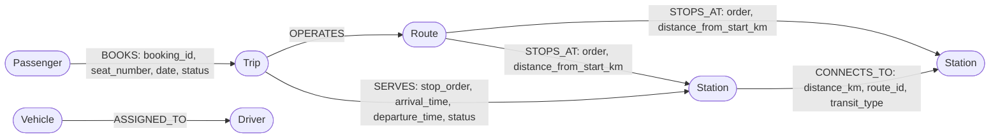

# Neo4j as a Complementary Graph Layer for TransitFlow

An academic justification for introducing a property-graph database into an existing
relational transit-management system, with the measurements actually taken during this
implementation.

Scope of this document: design rationale, graph schema, Cypher queries, a MySQL-vs-Neo4j
comparison, and test results. Every performance number below was measured on this laptop
(MySQL 9.7.1 and Neo4j Community, both local) and is reproduced from the queries in the
appendix. Where a claim could not be tested, it is labelled **proposed / untested**.

---

## 1. Problem statement

TransitFlow models a public bus and metro network. Operationally, the interesting questions
are about *connectivity*:

- Which stations does route R003 serve, in what order?
- Can a passenger travel from station A to station B, how many transfers does that take, and
  what is the shortest total distance?
- Which journeys, seats and tickets relate to a given passenger?
- If station X closes, which routes and trips lose a stop?

These are reachability and traversal questions over a network in which the *connections*
between things carry the meaning. The system already answered the first question well, but
the remaining ones were expressible only through join chains whose length is fixed by the
question, not by the data.

The task was therefore: keep MySQL as the authoritative store for the website's CRUD, and add
Neo4j as a second, purpose-built store for multi-hop network analytics — without replacing
tables, endpoints or teammate work.

---

## 2. Existing relational architecture

`database/schema.sql` defines 14 InnoDB tables in `transit_management`:

| Group | Tables |
| --- | --- |
| People | `passengers`, `passenger_contacts`, `drivers`, `driver_contacts` |
| Network | `stations`, `routes`, `route_stations` |
| Fleet | `vehicle_types`, `vehicles` |
| Operations | `trips`, `trip_stops` |
| Commercial | `bookings`, `payments`, `tickets` |

Three properties of this design matter for what follows:

1. **Association tables carry the topology.** `route_stations` is the M:N join between routes
   and stations, and it encodes *sequence* via `stop_order` and *position* via
   `distance_from_start_km`. The network graph is therefore implicit in ordered pairs.
2. **Weak entities depend on their owners.** `trip_stops` is keyed by
   `(trip_id, stop_order)`, so a stop cannot exist without its trip — good integrity, but the
   "edge" is a row that inherits its parent's identity.
3. **Constraints are declared once and enforced everywhere.** `vehicles.assigned_driver_id`
   is `UNIQUE` (1:1 driver-to-vehicle), `bookings` has a seat-conflict rule per
   `(trip_id, date, seat_number)`, and referential actions are `CASCADE`/`RESTRICT` as
   appropriate.

The relational model is the right choice for all of that. Nothing in this report argues
otherwise.

---

## 3. Limitations for graph-oriented transit queries

Three concrete frictions were observed while implementing the graph features.

**3.1 Traversal length is baked into the SQL.** Listing one route's stops is a three-table
join. Chaining *two* route segments needs a second self-join and a second alias; finding a
path of unknown length needs either application-side looping or a recursive CTE. In this
project the path query is:

```sql
WITH RECURSIVE search AS (
  SELECT a.station_id AS node, 0.0 AS dist, ... , 0 AS hops
  UNION ALL
  SELECT e.to_s, s.dist + e.km, ... , s.hops + 1
    FROM edges e JOIN search s ON s.node = e.from_s
   WHERE s.hops < 8 AND INSTR(s.path, CONCAT('>', e.to_s, '>')) = 0
)
SELECT ... ORDER BY dist ASC LIMIT 1;
```

That single statement required three workarounds that a graph database does not need:
an explicit hop bound (`s.hops < 8`), **manual cycle prevention** by keeping the visited-node
string in the recursion and testing `INSTR` (an edge case the relational engine cannot infer),
and — measured, not theorised — two failure modes during development: `CAST(0.0 AS DOUBLE)`
was needed in the anchor row because the recursive branch overflowed the `DECIMAL(2,1)` type
inferred from the literal `0.0`, and `CAST(... AS CHAR)` produced an
`Illegal mix of collations` error against the `utf8mb4_unicode_ci` columns.
MySQL also caps recursion with `cte_max_recursion_depth` (default 1000), so a session-level
override is required before the traversal is meaningful.

**3.2 Relationships have no identity of their own.** The distance of a segment between two
adjacent stops is stored as a *difference between two columns of two rows*
(`b.distance_from_start_km - a.distance_from_start_km`). There is no place to record a
transfer penalty, a mode change, or the fact that two different routes share the same
segment — each such fact needs another table plus another join.

**3.3 Questions about the network as a whole are awkward.** "Which stations are reachable
within three segments?" is a graph query; in SQL it is either a fixed-length join chain
(which silently under-answers, because it misses shorter paths) or the recursive CTE above.

None of this makes MySQL unable to do it. It makes the SQL formulation *longer, brittle about
depth, and untyped about the edge concept*.

---

## 4. Neo4j graph schema

### 4.1 Model



The eighth requested relationship type, `(:Vehicle)-[:ALLOCATED_TO]->(:Trip)`, is intentionally
absent from this diagram: the MySQL schema has no vehicle-to-trip table, so the sync does not
create it — see § 6.3.

### 4.2 Node labels and uniqueness constraints

| Label | Natural key | Constraint |
| --- | --- | --- |
| `Station` | `station_id` | `station_id_unique` |
| `Route` | `route_id` | `route_id_unique` |
| `Trip` | `trip_id` | `trip_id_unique` |
| `Vehicle` | `vehicle_id` | `vehicle_id_unique` |
| `Driver` | `driver_id` | `driver_id_unique` |
| `Passenger` | `passenger_id` | `passenger_id_unique` |

Plus two indexes used by the shipped queries: `station_city_idx` on `Station(city)` and
`trip_date_idx` on `Trip(date)`. All are created with `IF NOT EXISTS`, so the sync is safe to
re-run, and they exist before any `MERGE` so node lookup stays indexed.

### 4.3 Relationship types

| Type | Properties | MySQL source |
| --- | --- | --- |
| `CONNECTS_TO` | `distance_km`, `route_id`, `transit_type` | consecutive `route_stations` pairs, both directions |
| `STOPS_AT` | `order`, `distance_from_start_km` | `route_stations` |
| `SERVES` | `stop_order`, `arrival_time`, `departure_time`, `status` | `trip_stops` |
| `OPERATES` | `sync_batch` | `trips.route_id` |
| `ASSIGNED_TO` | `sync_batch` | `vehicles.assigned_driver_id` |
| `BOOKS` | `booking_id`, `seat_number`, `date`, `status` | `bookings` |
| `HAS_TICKET` | `ticket_id`, `ticket_type`, `travel_class`, `issue_date` | `tickets` joined to `bookings` |

`Vehicle` and `Driver` nodes exist and are linked to each other; `ALLOCATED_TO` is the only
type in the requested model that has no relational source. Rather than invent trip-vehicle
assignments, the sync emits an explicit warning:

> Vehicle-to-trip allocation is not modelled in the MySQL schema, so no `:ALLOCATED_TO`
> relationships are created by the sync.

### 4.4 State after the last sync (seeded database)

```
Nodes          Driver 2 · Passenger 3 · Route 3 · Station 4 · Trip 1 · Vehicle 2
Relationships  ASSIGNED_TO 2 · BOOKS 1 · CONNECTS_TO 10 · HAS_TICKET 1
               OPERATES 1 · SERVES 3 · STOPS_AT 8
```

---

## 5. Implementation and important Cypher queries

### 5.1 Connection management

`backend/config/neo4j.js` keeps a **singleton driver** with a bounded connection pool
(`maxConnectionPoolSize: 50`) and exposes `runCypher(query, params, mode)`, which opens a
session, runs, and closes it in a `finally` block. Sessions are therefore never leaked, even
on error. `backend/server.js` calls `closeNeo4jDriver()` and `pool.end()` on `SIGINT`/`SIGTERM`.

`MySQL → Neo4j` projection is **not** a distributed transaction, and this implementation does
not pretend otherwise. MySQL is committed first; the graph write follows. If the graph write is
rejected, the booking endpoint still answers `201` — the relational record is authoritative —
with `data.graph: null` and a message naming the reason and the repair step
(`Run POST /api/graph/sync to refresh`), and the next sync reconciles from the relational rows.
Consistency is therefore *eventual and repairable*, which is the honest property of this
architecture.

### 5.2 Idempotent sync with stale-element pruning

Each element written by a run is stamped with that run's batch marker:

```cypher
UNWIND $rows AS row
MATCH (r:Route {route_id: row.route_id})
MATCH (s:Station {station_id: row.station_id})
MERGE (r)-[stop:STOPS_AT {order: row.stop_order}]->(s)
SET stop.distance_from_start_km = row.distance_from_start_km, stop.sync_batch = $batch
```

and after all elements are written, anything the current MySQL snapshot no longer justifies is
deleted:

```cypher
MATCH ()-[r]->() WHERE r.sync_batch IS NULL OR r.sync_batch <> $batch DELETE r
MATCH (n)     WHERE n.sync_batch IS NULL OR n.sync_batch <> $batch DETACH DELETE n
```

This is what makes the script repeatable *and* convergent: inserting rows is reflected by
`MERGE`, deleting rows in MySQL is reflected by pruning. Without this step (the first version
had none) a `:BOOKS` edge survived the deletion of its booking row, and the passenger-journey
query reported a journey that no longer existed — a real bug found and fixed during testing.

### 5.3 Feature A — stations along a route

```cypher
MATCH (r:Route {route_id: $routeId})-[s:STOPS_AT]->(st:Station)
RETURN st.station_id AS stationId, st.name AS stationName,
       s.order AS stopOrder, s.distance_from_start_km AS distanceFromStartKm
ORDER BY s.order ASC
```

One relationship hop, ordered by a property that lives on the relationship. Unknown routes
answer `404` with "Run the MySQL-to-Neo4j sync" rather than an empty list, which distinguishes
"no stops" from "not projected yet".

### 5.4 Feature B — weighted shortest path (the interesting one)

`shortestPath()` in Cypher minimises the **number of relationships**, not the summed weight.
For a transit network those are different answers, so the shipped query enumerates bounded
trails and orders them by accumulated distance:

```cypher
MATCH path = (o:Station {station_id: $originId})
              -[:CONNECTS_TO*1..$hopLimit]->(d:Station {station_id: $destinationId})
WITH path, reduce(acc = 0.0, r IN relationships(path) | acc + r.distance_km) AS totalKm
RETURN [n IN nodes(path) | {...}] AS stations,
       [r IN relationships(path) | {...}] AS hops,
       length(path) AS hopCount, totalKm
ORDER BY totalKm ASC, hopCount ASC
LIMIT 1
```

`reduce()` over `relationships(path)` is what makes the result distance-optimal among the
enumerated trails; ties fall back to fewer hops. Every value (`originId`, `destinationId`) is a
query parameter. The one interpolated token is the path-length upper bound, because Cypher
requires a literal there; it is derived as `Math.trunc(Number(raw))` clamped to `1..10`, so it
cannot carry user text. `maxHopsExplored` is returned in the payload so the bound is visible to
the reader of the result.

The response also contains a comparison block computed from a second query using
`shortestPath()`, so the hop-vs-distance distinction is demonstrated rather than asserted — see
§ 8.1.

### 5.5 Feature C — passenger journeys

```cypher
MATCH (p:Passenger {passenger_id: $passengerId})
OPTIONAL MATCH (p)-[b:BOOKS]->(t:Trip)-[:OPERATES]->(r:Route)
WITH p, t, r, b ORDER BY b.date
WITH p, collect({bookingId: b.booking_id, tripId: t.trip_id, seatNumber: b.seat_number,
                  date: b.date, status: b.status, routeId: r.route_id, routeName: r.name,
                  stops: size([(t)-[:SERVES]->(s) | s])}) AS rows
RETURN p.passenger_id AS passengerId,
       p.first_name + ' ' + p.last_name AS name,
       [x IN rows WHERE x.bookingId IS NOT NULL] AS journeys
```

`OPTIONAL MATCH` keeps a passenger with no bookings in the result as an empty `journeys` array
instead of a `404`. A second query expands each journey into its ordered `SERVES` stations to
report boarding and alighting stops.

### 5.6 Booking demo, concurrency-safe

`POST /api/graph/bookings` writes the authoritative row first, inside a MySQL transaction that
locks the trip row (`SELECT … FOR UPDATE`), allocates the next `booking_id`, and relies on the
schema's seat-conflict rule:

```sql
SELECT trip_id FROM trips WHERE trip_id = ? FOR UPDATE;
SELECT MAX(CAST(SUBSTRING(booking_id, 2) AS UNSIGNED)) AS highest
  FROM bookings WHERE booking_id REGEXP '^B[0-9]+$';
-- then insertResource(...) inside the same transaction
```

Only after the commit does it `MERGE` the `(:Passenger)-[:BOOKS]->(:Trip)` edge. A double submit
for the same seat therefore fails in MySQL — the place where the constraint actually lives —
and never produces a graph edge that has no relational backing. Payment data is deliberately
out of this endpoint: it stores and returns only booking identity (seat, date, status), not
transaction references or amounts.

### 5.7 Degradation when Neo4j is offline

`backend/utils/http.js` recognises Neo4j failure codes (`ServiceUnavailable`,
`Neo.TransientError.General.DatabaseUnavailable`, `ECONNREFUSED`,
`UND_ERR_CONNECT_TIMEOUT`, `UNAVAILABLE`, and `Neo.ClientError.Security*`) and maps them to
`503` with the message *"The Neo4j graph database is unavailable. MySQL CRUD is unaffected."*
Because the two engines are reached through separate route trees (`/api/*` vs `/api/graph/*`)
and separate connection modules, a graph outage cannot surface as a MySQL outage. Verified in
§ 8.3.

---

## 6. Advantages and limitations

### 6.1 Advantages actually observed

- **Traversal length becomes data, not code.** Feature A and Feature C are one-hop and
  three-hop patterns written once; extending them to N hops does not add a join or an alias.
- **Edges carry properties.** `CONNECTS_TO.distance_km`, `STOPS_AT.order`, `SERVES.arrival_time`
  are stored on the relationship, so ordering and weight need no arithmetic across sibling rows.
- **The distance-optimal path is expressible in one statement**, including the hop-optimal
  counter-example, which in SQL needed a recursive CTE with manual cycle detection.
- **Connectivity questions read naturally.** "Where can I get to from here?" is a pattern match
  rather than a query plan the reader has to reconstruct.

### 6.2 Limitations and costs

- **Two stores, two failure modes.** Availability now depends on both engines; the sync and the
  `503` mapping are the mitigation, not a cure.
- **No cross-engine atomicity.** A MySQL transaction does not make the graph write atomic.
  Consistency is eventual and repaired by re-sync; this is stated in code and in the API
  response (`graphWarning`).
- **Replication lag is operator-controlled.** The graph only reflects MySQL after a sync, so
  the explorer can show a stale network between writes and syncs.
- **Bounded trail enumeration is not Dijkstra.** Its cost grows with the number of trails within
  the hop bound (branching factor ^ hops in the worst case), which is acceptable for the hop
  limits used here (`≤ 10`) and for the test sizes in § 8.2, but it is not a scalable exact
  weighted shortest-path algorithm for a city-wide network.
- **Neo4j Community Edition** means one database, no causal-consistency clustering, and no
  Aura features.

### 6.3 Model gaps that were *not* papered over

- `ALLOCATED_TO` has no relational source; not created, warned explicitly.
- **Payment data never enters the graph.** The relational snapshot for the sync reads ticket
  identity, issue date, type and travel class only — no `amount`, no `payment_mode`, no
  `txn_reference_no`. (`backend/database/neo4j_seed.cypher`, an earlier hand-written seed kept
  for reference, still contains example payment properties; it is superseded by the sync script
  and is not executed by the application.)
- **Passenger contact and address fields are projected** onto `:Passenger` because the sync is a
  faithful copy of the row. No shipped graph endpoint returns them — `passengers/:id/journeys`
  answers id, name, seat, date, status and route, and `/network` returns only station topology —
  but the store itself is not more private than MySQL, so it must be treated with the same access
  controls.
- Timetable realism: `arrival_time`/`departure_time` come from `trip_stops`, so the graph can
  only reason about scheduled stops, not live vehicle positions.

---

## 7. MySQL versus Neo4j comparison

| Aspect | MySQL (relational) | Neo4j (property graph) |
| --- | --- | --- |
| Data model | Tables, rows, foreign keys | Nodes, directed relationships, properties on both |
| Strength here | Entity CRUD, constraints, accounting integrity | Multi-hop network traversal |
| Relationship identity | Implicit in matching key columns | First-class, with its own properties |
| Fixed 1-hop lookups | Excellent, indexed joins | Comparable, no advantage worth the second store |
| Variable-length traversal | Recursive CTE: depth bound, manual cycle guard, collation/type casts | `[:CONNECTS_TO*1..n]` in one pattern |
| Weighted shortest path | Hand-rolled recursion ordered by an accumulated column | `reduce()` over `relationships(path)` |
| Referential guarantees | `FOREIGN KEY`, `UNIQUE`, `RESTRICT` — enforced on write | Constraints guard uniqueness only; existence is validated in the sync |
| Transactions | Mature, `FOR UPDATE` row locks | ACID per-statement/`executeWrite`, single store |
| Query languages | SQL (declarative, set-based) | Cypher (pattern-based, ASCII graph syntax) |
| Failure blast radius | Total — it is the source of truth | Analytical only; `/api/graph/*` degrades to 503 |
| Role in TransitFlow | **Authoritative** for every screen | **Derived projection** for network analytics |

The correct conclusion is the one the brief asked for: Neo4j *complements* MySQL here. Writes,
constraints and money stay relational; connectivity questions are read from the graph.

---

## 8. Testing results

All results below were produced by running this code against the seeded
`transit_management` schema and a local Neo4j Community instance. Methodology: one warm-up call
excluded, then 5–20 repeats; wall-clock times include HTTP and Node process startup, which is
why `/api/passengers` floors at ~0.02 s.

### 8.1 Distance optimality is demonstrated, not claimed

Request: `GET /api/graph/path/shortest?originId=S004&destinationId=S003`

| | Hops | Total distance | Route used |
| --- | --- | --- | --- |
| Returned (distance-optimal) | 2 | **14.5 km** | R004 then R001 |
| `hopCountOptimalComparison` (hop-optimal) | 2 | 36.0 km | R004 then R003 (metro express) |

A shorter-hop alternative exists only once hops are equal, so the payload also proves the two
strategies disagree on cost. The same optimum was cross-checked against the relational engine:
the recursive CTE of § 3.1 returned `{hops: 2, dist: 14.5, path: 'S004>S002>S003>'}` — the two
engines agree, which validates the graph traversal against an independent computation.

### 8.2 Latency and a synthetic scaling probe

On the seeded production-shaped dataset (4 stations, 10 `CONNECTS_TO` edges), averaged at the
query layer:

| Operation | Neo4j | MySQL |
| --- | --- | --- |
| Weighted path S004 → S003 | 3.8 – 16.1 ms | 0.9 – 1.5 ms |
| Ordered stops of R003 | 1.2 – 6.1 ms | 0.5 – 1.1 ms |

**At this scale MySQL is faster**, and no performance improvement is claimed for it.

A synthetic grid (scratch database `transit_bench` and scratch labels `:SynStation` /
`:SYN_CONNECTS`, both destroyed afterwards; nothing touched the real schema) queried between two
nodes 8 hops apart:

| Stations | Directed edges | Neo4j (ms) | MySQL recursive CTE (ms) | Both engines found |
| --- | --- | --- | --- | --- |
| 100 | 360 | 11.3 | 9.6 | 8 hops @ 21 km |
| 400 | 1 520 | 6.8 | 10.4 | 8 hops @ 21 km |
| 900 | 3 480 | 5.5 | 13.3 | 8 hops @ 21 km |

Interpretation, stated conservatively: the relational traversal grew with network size while
the graph traversal stayed roughly flat, and the two engines agreed on the same optimum at every
size. These are single-machine, in-process, warm-session numbers on an artificial lattice — they
are indicative of the *shape* of the two approaches, not evidence of a production speed-up, and
they are not extrapolated beyond 900 nodes.

End-to-end HTTP, measured with `curl` against the running API on the seeded dataset:

| Endpoint | Wall clock |
| --- | --- |
| `GET /api/passengers` | 0.02 s |
| `GET /api/dashboard` | 0.02 s |
| `GET /api/graph/health` | 0.21 s |
| `GET /api/graph/routes/R003/stations` | 0.14 s |
| `GET /api/graph/path/shortest?...` | 0.22 s |
| `GET /api/graph/passengers/P001/journeys` | 0.28 s |
| `npm run sync:graph` (full projection of all 14 tables) | 1.59 s |

### 8.3 Functional checklist (each item executed, not inferred)

| # | Test | Result |
| --- | --- | --- |
| 1 | Passenger create with two contact tags, then update, then delete | passed — rows and `passenger_contacts` written in one transaction |
| 2 | Duplicate `passenger_id` | passed — `409 Passenger P001 already exists.` |
| 3 | Delete a station referenced by routes/trip stops | passed — `409 Station S001 is referenced by 3 route stops and 1 trip stop.` |
| 4 | `?force=true` delete | passed — cascade fired, referencing rows removed |
| 5 | Trip creation with three stops | passed — atomic; trip and `trip_stops` appear together |
| 6 | Booking checkout (booking + payment + ticket) | passed — one transaction, boarding pass renders |
| 7 | `GET /api/trips/:id/stops`, `GET /api/routes/:id/stops` | fixed then passed (a `rows.map(mapRow)` arity bug returned 500) |
| 8 | `GET /api/graph/health` | passed — labels, relationship types and counts |
| 9 | Feature A on R003 | passed — ordered stops |
| 10 | Feature B, including the hop-vs-distance payload | passed — see § 8.1 |
| 11 | Feature C for P001 (one booking) | passed — journey, seat, boarding/alighting stops |
| 12 | `POST /api/graph/bookings` twice for the same seat | passed — second attempt rejected by MySQL before any graph write |
| 13 | Sync idempotency: run twice | passed — identical counts, no duplicate nodes or edges |
| 14 | Sync pruning after deleting a booking row | passed — `:BOOKS` dropped 2 → 1, `pruned {relationships: 1, nodes: 0}` |
| 15 | Sync from a clean graph (`--clean`) | passed — 10 `CONNECTS_TO` rebuilt (an earlier bug produced 0) |
| 16 | Neo4j stopped, then `/api/graph/*` | passed — `503` with the MySQL-unaffected message |
| 17 | Neo4j stopped, then MySQL CRUD and dashboard | passed — unaffected |
| 18 | Graph Explorer with Neo4j offline | passed — offline banner, panels show errors, app does not crash |
| 19 | Frontend production build | passed — `tsc && vite build`, 1 595 modules, no type errors |
| 20 | API unreachable from the client | passed — request timeout produces "The TransitFlow API … is unreachable. Is the backend running?" instead of an infinite spinner |

### 8.4 Screenshots to capture for the submission

1. `mysql -u root -p -e "USE transit_management; SHOW TABLES;"` — 14 tables.
2. React app, Passengers module, immediately after creating a passenger — toast plus the new row
   (proves the write went through the API, not mock data).
3. The `409` reference guard: attempting to delete `S001` from the Routes module.
4. Graph Explorer health bar showing `CONNECTED` with the node-count summary.
5. Feature A: ordered station list for `R003`.
6. Feature B: `S004 → S003` returning 2 hops / 14.5 km **with** the "fewest hops = 2 hop(s) at
   36 km" comparison line visible.
7. Feature C: `P001` journey with seat `A01` and boarding/alighting stations.
8. Terminal output of `npm run sync:graph`, including the `:ALLOCATED_TO` limitation note and the
   pruned-elements line.
9. Neo4j Browser (`http://localhost:7474`) running
   `MATCH path=(a:Station {station_id:'S004'})-[:CONNECTS_TO*1..8]->(b:Station {station_id:'S003'}) RETURN path` — the highlighted cheapest trail.
10. Graph Explorer with Neo4j stopped: the offline banner, while the Passengers table still loads.

---

## 9. Conclusion

The relational layer remains the correct place for TransitFlow's entities, constraints and money.
Adding Neo4j changed three things in a measurable way: connectivity questions became one-pattern
Cypher instead of depth-bound recursive SQL; relationships acquired their own properties; and the
distance-optimal path became a single query whose result can be, and was, cross-checked against
an independent relational computation.

It also added real costs: a second store to keep consistent, an explicit sync step, an eventual
rather than atomic guarantee between engines, and a shortest-path algorithm that is exact within
a hop bound rather than a general Dijkstra. Those costs are visible in the code, not hidden in
prose.

### What is implemented versus proposed

| Item | Status |
| --- | --- |
| MySQL CRUD for all 14 tables behind the React UI | **implemented and tested** |
| Transactions, validation, reference-aware delete guard, unified errors | **implemented and tested** |
| Neo4j driver, constraints, indexes, health endpoint | **implemented and tested** |
| Idempotent MySQL → Neo4j sync with stale-element pruning | **implemented and tested** |
| Features A, B (distance-optimal + hop comparison), C | **implemented and tested** |
| Graph Explorer UI with loading/error/offline states | **implemented and tested** |
| `503` degradation isolating Neo4j outages from MySQL | **implemented and tested** |
| `ALLOCATED_TO` population | **proposed** — needs a `trip_vehicles` table first; not invented |
| True Dijkstra/APO or `gds.shortestPath.*` routing | **proposed / untested** — Community Edition lacks the GDS library |
| Transfer-aware and time-dependent routing (earliest arrival) | **proposed / untested** |
| Change-data-capture or incremental sync instead of full re-projection | **proposed / untested** |
| Performance claims at city scale | **not supported** — § 8.2 stops at 900 synthetic nodes |

---

## Appendix — reproduction queries

```bash
# distance-optimal vs hop-optimal, through the API
curl "http://localhost:5000/api/graph/path/shortest?originId=S004&destinationId=S003"

# same optimum computed relationally (the cross-check in § 8.1)
mysql -u root -p transit_management -e "
SET SESSION cte_max_recursion_depth = 1000000;
WITH RECURSIVE edges AS (
  SELECT a.station_id AS from_s, b.station_id AS to_s,
         CAST(b.distance_from_start_km - a.distance_from_start_km AS DOUBLE) AS km
    FROM route_stations a JOIN route_stations b
      ON b.route_id = a.route_id AND b.stop_order = a.stop_order + 1
  UNION ALL
  SELECT b.station_id, a.station_id,
         CAST(b.distance_from_start_km - a.distance_from_start_km AS DOUBLE)
    FROM route_stations a JOIN route_stations b
      ON b.route_id = a.route_id AND b.stop_order = a.stop_order + 1),
search AS (
  SELECT 'S004' AS node, CAST(0.0 AS DOUBLE) AS dist, 'S004>' AS path, 0 AS hops
  UNION ALL
  SELECT e.to_s, s.dist + e.km, CONCAT(s.path, e.to_s, '>'), s.hops + 1
    FROM edges e JOIN search s ON s.node = e.from_s
   WHERE s.hops < 8 AND INSTR(s.path, CONCAT('>', e.to_s, '>')) = 0)
SELECT hops, dist, path FROM search WHERE node = 'S003' ORDER BY dist ASC LIMIT 1;"
```

The temporary benchmark harnesses used for § 8.2 were throwaway scripts; they were deleted after
the measurements, and their synthetic data lived only in the scratch database `transit_bench` and
the scratch labels `:SynStation` / `:SYN_CONNECTS`, both removed.
