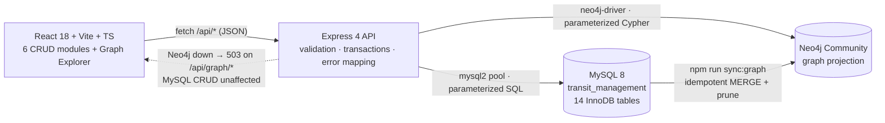
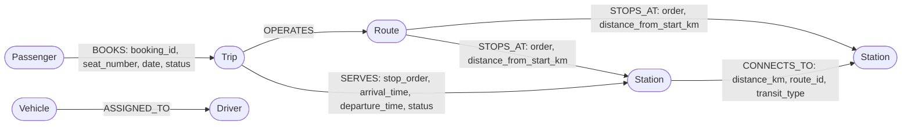

# TransitFlow — Public Bus & Metro Transit Management System

React 18 + Vite + TypeScript front end · Express + **MySQL** CRUD API · **Neo4j** graph layer for
network connectivity queries.

This repository is organised into two deliverable folders:

```
transit-management-system/
├── README.md     ← this file: the complete reference for the final project (DA3)
├── DA2/          ← the project as it already existed in this repository (verbatim snapshot)
└── DA3/          ← the final project: full-stack MySQL CRUD + Neo4j graph layer
```

| | **DA2 — baseline** | **DA3 — final** |
| :--- | :--- | :--- |
| Tracked files | 48 | 68 |
| Front end | React 18 + Vite + TS, Tailwind, modules for passengers, routes, fleet, trips, bookings | Same, plus a **Graph Explorer** module; `src/services/mockData.ts` removed |
| Back end | `backend/server.js` single-file stub, no service/controller/route layering | Complete Express API: config, models, services, controllers, routes, middleware, utils |
| MySQL | `database/schema.sql` (14 tables + seed) | Unchanged schema, now fully wired with parameterized SQL, transactions and integrity guards |
| Neo4j | — | `neo4j-driver` projection, idempotent MySQL→graph sync, three graph features, health endpoint |
| Docs | Short README | Full README (834 lines) + `docs/GRAPH_DATABASE_JUSTIFICATION.md` (549-line academic report) |

**DA2 is a verbatim snapshot** — nothing inside it was edited, so the two folders can be diffed to
see exactly what this iteration changed. **DA3 is the version to run and submit.**

---

## 1. What DA3 adds over DA2

**New (21 files)** — `backend/config/{db.js,neo4j.js}`, `backend/models/`, `backend/services/{resourceService.js,compositeService.js,graphSyncService.js}`,
`backend/controllers/neo4jTransitController.js`, `backend/routes/{resourceRoutes.js,neo4jRoutes.js}`,
`backend/middleware/`, `backend/utils/{http.js,errors.js}`,
`backend/database/{neo4j_seed.cypher,sync-mysql-to-neo4j.js}`,
`src/components/modules/graph/GraphExplorer.tsx`, `docs/GRAPH_DATABASE_JUSTIFICATION.md`,
both `package-lock.json` files, `src/vite-env.d.ts`.

**Modified (22 files)** — `backend/server.js`, `backend/package.json`, `backend/.env.example`,
`database/schema.sql` (header comment only), `README.md`, `src/App.tsx`, layout `Header`/`Sidebar`,
every module and modal component, `src/context/TransitContext.tsx`, `src/services/api.ts`,
`src/types/transit.ts`.

**Deleted (1 file)** — `src/services/mockData.ts`. The UI has no mock fallback, so an empty table
now means the API genuinely returned no rows.

---

## 2. Architecture

MySQL is the **source of truth** for every entity, constraint and payment. Neo4j is an additional
store for network-topology questions; it never replaces a CRUD path.



```
Browser  ─  DA3/src/services/api.ts  (abort-signal timeout + envelope parsing)
              │
Express  ─  routes → controllers → services → config/{db,neo4j}
              │                                    │
MySQL    ─  transit_management, 14 tables  ◄───────┘  source of truth
Neo4j    ─  15 nodes / 26 relationships     ◄──────── projection, synced from MySQL
```

---

## 3. Data model

### 3.1 MySQL (`DA3/database/schema.sql`)

14 InnoDB tables: `passengers`, `passenger_contacts`, `drivers`, `driver_contacts`, `stations`,
`routes`, `route_stations`, `vehicle_types`, `vehicles`, `trips`, `trip_stops`, `bookings`,
`payments`, `tickets`.

- **Multi-valued contacts** are normalised into `passenger_contacts` / `driver_contacts` with a
  composite `(id, phone_number)` key and `ON DELETE CASCADE`.
- **Seat collisions are impossible by construction**: `bookings` has
  `UNIQUE KEY uq_trip_seat_date (trip_id, seat_number, date)`.
- **1:1 driver–vehicle** assignment is enforced by `assigned_driver_id VARCHAR(20) UNIQUE`.
- **Weak entity** `trip_stops` depends on `trips` through `(trip_id, stop_order)`.

> ⚠️ `schema.sql` opens with `DROP DATABASE IF EXISTS transit_management`, so **re-running it wipes
> saved data.** Its seed block creates 4 stations, 3 routes, 2 vehicle types, 2 drivers, 2 vehicles,
> 1 trip with 3 stops and 1 booked journey — and deliberately includes both a cheap two-hop journey
> and a pricier one-hop express alternative so distance-vs-hop-count optimisation is observable.

### 3.2 Neo4j

Six node labels, all keyed by their MySQL primary key with a `..._id_unique` constraint:

| Label | Natural key | Nodes after sync |
| :--- | :--- | --- |
| `Station` | `station_id` | 4 |
| `Route` | `route_id` | 3 |
| `Trip` | `trip_id` | 1 |
| `Vehicle` | `vehicle_id` | 2 |
| `Driver` | `driver_id` | 2 |
| `Passenger` | `passenger_id` | 3 |

| Relationship | Edge properties | Projected from | Count |
| :--- | :--- | :--- | :--- |
| `(:Station)-[:CONNECTS_TO {route_id}]->(:Station)` | `distance_km`, `route_id`, `transit_type` | consecutive `route_stations` pairs, both directions | 10 |
| `(:Route)-[:STOPS_AT {order}]->(:Station)` | `order`, `distance_from_start_km` | `route_stations` | 8 |
| `(:Trip)-[:SERVES {stop_order}]->(:Station)` | `stop_order`, `arrival_time`, `departure_time`, `status` | `trip_stops` | 3 |
| `(:Vehicle)-[:ASSIGNED_TO]->(:Driver)` | `sync_batch` | `vehicles.assigned_driver_id` | 2 |
| `(:Trip)-[:OPERATES]->(:Route)` | `sync_batch` | `trips.route_id` | 1 |
| `(:Passenger)-[:BOOKS {booking_id}]->(:Trip)` | `booking_id`, `seat_number`, `date`, `status` | `bookings` | 1 |
| `(:Passenger)-[:HAS_TICKET {ticket_id}]->(:Trip)` | `ticket_id`, `ticket_type`, `travel_class`, `issue_date` | `tickets` joined to `bookings` | 1 |

Total after a clean sync on the seeded data: **15 nodes, 26 relationships.**



**Payment data never enters the graph.** The projection reads only `ticket_id`, `booking_id`,
`issue_date`, `ticket_type`, `travel_class` — no amounts, no transaction references.

---

## 4. Setup and run (all commands from inside `DA3/`)

### 4.1 Environment

`DA3/.env.example` and `DA3/backend/.env.example` contain placeholders only — copy them and fill in
**your own** credentials; never commit the real values.

```bash
cd DA3
cp .env.example .env
cd backend && cp .env.example .env
```

`backend/.env`:

```env
PORT=5000
DB_HOST=localhost
DB_USER=root
DB_PASSWORD=your_mysql_password
DB_NAME=transit_management
DB_PORT=3306

# Optional graph layer. The app runs without it: /api/graph/* answers 503
# and every MySQL endpoint keeps working.
NEO4J_URI=neo4j://localhost:7687
NEO4J_USER=neo4j
NEO4J_PASSWORD=your_neo4j_password
NEO4J_DATABASE=neo4j
```

> **Before making this repository public**, remove the `|| 'password'` fallback in
> `backend/config/neo4j.js:8` (and the `DB_PASSWORD` fallback next to it) so a missing environment
> variable fails loudly instead of trying a default credential.

### 4.2 MySQL

```bash
mysql -u root -p < database/schema.sql          # creates the schema + demo rows

USE transit_management;
SHOW TABLES;                                    # 14 tables
SELECT COUNT(*) FROM stations;                  # 4
SELECT COUNT(*) FROM route_stations;            # 8
SELECT COUNT(*) FROM bookings;                  # 1
```

### 4.3 Backend and frontend

```bash
cd DA3/backend
npm install
npm run dev                                     # http://localhost:5000

# second terminal
cd DA3
npm install
npm run dev                                     # http://localhost:5173
```

```bash
curl http://localhost:5000/api/health           # MySQL connectivity + server version
curl http://localhost:5000/api/graph/health     # Neo4j status, or 503 when Neo4j is offline
```

### 4.4 Neo4j (optional)

```bash
docker run -d --name transit-neo4j -p 7474:7474 -p 7687:7687 \
  -e NEO4J_AUTH=neo4j/your_neo4j_password neo4j:5-community

cd DA3/backend
npm run sync:graph                              # idempotent — safe to re-run
npm run sync:graph:clean                        # wipe the labels and rebuild from scratch
curl -X POST http://localhost:5000/api/graph/sync   # same refresh over HTTP
```

`sync:graph` reads every MySQL table, `MERGE`s nodes and relationships on their natural keys, tags
each element with a `sync_batch`, then deletes graph elements whose rows no longer exist, and prints
per-label counts. Re-running it on unchanged data produces identical counts and no duplicates.

---

## 5. REST API

Every response uses one envelope: `{"success": true, "data": …}` or
`{"success": false, "error": "…", "details": …}`. Errors are mapped from MySQL and Neo4j error codes,
so a duplicate key, an unknown foreign key and a broken unique index each get their own `409`/`400`
message instead of a generic `500`.

### 5.1 MySQL CRUD

| Method | Path | Notes |
| :--- | :--- | :--- |
| GET | `/api/health` | MySQL connectivity + server version |
| GET | `/api/dashboard` | Aggregated counts for the operations dashboard |
| GET/POST | `/api/passengers` | Create writes passenger **and** contact rows in one transaction |
| GET/PUT/DELETE | `/api/passengers/:id` | Delete returns `409` while bookings reference the row; `?force=true` cascades |
| — | `/api/stations`, `/api/routes`, `/api/route-stations`, `/api/vehicle-types`, `/api/drivers`, `/api/vehicles`, `/api/trip-stops`, `/api/payments`, `/api/tickets`, `/api/bookings` | Same CRUD shape and constraint handling |
| GET | `/api/routes/:routeId/stops` | Ordered stop list |
| PUT | `/api/routes/:routeId/station-order` | Re-sequences stops atomically |
| POST | `/api/trips` | Creates the trip **and** its `trip_stops` in one transaction |
| GET | `/api/trips/:tripId/stops` | Weak-entity timeline |
| POST | `/api/bookings/checkout` | Booking + payment + ticket in one transaction |

**Create a passenger**

```bash
curl -X POST http://localhost:5000/api/passengers \
  -H 'Content-Type: application/json' \
  -d '{"passengerId":"P010","firstName":"Meena","lastName":"Ravi",
       "email":"meena@example.com","gender":"F","dob":"2001-04-18",
       "city":"Chennai","state":"TN","pin":"600017",
       "contacts":["9876500010","9876500011"]}'
```

```json
{ "success": true,
  "data": { "passengerId": "P010", "firstName": "Meena", "contacts": ["9876500010", "9876500011"] } }
```

**The accidental-deletion guard**

```bash
curl -X DELETE http://localhost:5000/api/stations/S001
```

```json
{ "success": false,
  "error": "Station S001 is referenced by 3 route stops and 1 trip stop. Delete or reassign those records first." }
```

HTTP `409`. Referencing rows are counted per table *before* the `DELETE` is issued, so the operator
is told which records to fix rather than reading it out of a MySQL foreign-key error. An intentional
cascade is available as `DELETE /api/stations/S001?force=true`, which skips the guard and lets the
schema's own `ON DELETE CASCADE` rules run.

### 5.2 Neo4j graph

| Method | Path | Feature |
| :--- | :--- | :--- |
| GET | `/api/graph/health` | Connectivity + counts per label and relationship type |
| POST | `/api/graph/sync` | Re-project MySQL → Neo4j and prune deleted rows |
| GET | `/api/graph/routes/:routeId/stations` | **A** — ordered stations along a route |
| GET | `/api/graph/path/shortest?originId=&destinationId=&maxHops=` | **B** — distance-weighted shortest path |
| GET | `/api/graph/passengers/:passengerId/journeys` | **C** — passenger / booking traversal |
| POST | `/api/graph/bookings` | **C** — booking demo; the graph edge is written only after MySQL commits |
| GET | `/api/graph/network` | Every `CONNECTS_TO` edge (the explorer's topology panel) |

**Feature B response** — `GET /api/graph/path/shortest?originId=S004&destinationId=S003`:

```json
{
  "success": true,
  "data": {
    "originId": "S004", "destinationId": "S003",
    "strategy": "weighted-distance (bounded trail enumeration ordered by summed distance_km)",
    "maxHopsExplored": 8,
    "totalHops": 2, "totalDistanceKm": 14.5,
    "pathStations": [
      { "stationId": "S004", "name": "T. Nagar Bus Hub" },
      { "stationId": "S002", "name": "Guindy Junction" },
      { "stationId": "S003", "name": "Airport Terminal" }
    ],
    "transitHops": [
      { "routeId": "R004", "transitType": "Bus", "distanceKm": 8 },
      { "routeId": "R001", "transitType": "Bus", "distanceKm": 6.5 }
    ],
    "hopCountOptimalComparison": { "hopCount": 2, "totalDistanceKm": 36, "routes": ["R004", "R003"] }
  }
}
```

`hopCountOptimalComparison` is the evidence that the search minimises **distance, not edges**: an
equal-hop metro express alternative costs 36 km and the endpoint still returns the 14.5 km route.

**When Neo4j is stopped**, the graph routes answer `503` and every MySQL CRUD route keeps working:

```json
{ "success": false,
  "error": "The Neo4j graph database is unavailable. MySQL CRUD is unaffected.",
  "details": "Failed to connect to 127.0.0.1:7687 - connect ECONNREFUSED" }
```

---

## 6. Front-end modules

1. **Passengers** — full CRUD, dynamic multi-phone tag editor, email regex and 6-digit PIN validation.
2. **Routes & stations** — Bus/Metro classification, total distance, station CRUD, and an interactive
   route-station sequencer with cumulative distances.
3. **Fleet** — vehicle types (Diesel/Electric/CNG), drivers with licence checks, vehicles with a live
   1:1 assignment-collision warning.
4. **Trips** — schedule CRUD plus a visual stop timeline (`Departed` / `On Time` / `Delayed` / `Scheduled`).
5. **Bookings** — seat-reservation with collision prevention, UPI/Card/Cash payments, digital boarding pass.
6. **Graph Explorer** *(new in DA3)* — health bar with per-label node counts, `Check health` and
   `Sync from MySQL` actions, Features A/B/C panels, and the full `CONNECTS_TO` edge list. Every panel
   has loading, error, empty and success states; when Neo4j is offline it shows an offline banner
   instead of crashing the page.

---

## 7. Results actually measured

Full detail in `DA3/docs/GRAPH_DATABASE_JUSTIFICATION.md` § 8.

**Distance optimality, cross-checked against MySQL.** The graph result above (2 hops / 14.5 km) was
reproduced independently by a recursive CTE on the relational engine, which returned
`{hops: 2, dist: 14.5, path: 'S004>S002>S003>'}`.

**Latency — no speed-up is claimed.** On the seeded dataset (4 stations, 10 `CONNECTS_TO` edges):

| Operation | Neo4j | MySQL |
| :--- | :--- | :--- |
| Weighted path `S004 → S003` | 3.8 – 16.1 ms | **0.9 – 1.5 ms** |
| Ordered stops of `R003` | 1.2 – 6.1 ms | **0.5 – 1.1 ms** |

At this scale **MySQL is faster**; Neo4j is justified by query expressiveness, not speed. A synthetic
lattice (scratch database, destroyed afterwards; 8 hops between endpoints):

| Stations | Directed edges | Neo4j (ms) | MySQL recursive CTE (ms) | Both found |
| :--- | :--- | :--- | :--- | :--- |
| 100 | 360 | 11.3 | 9.6 | 8 hops @ 21 km |
| 400 | 1 520 | 6.8 | 10.4 | 8 hops @ 21 km |
| 900 | 3 480 | 5.5 | 13.3 | 8 hops @ 21 km |

The relational traversal grew with network size while the graph traversal stayed roughly flat, and
the two engines agreed on the same optimum at every size. These are single-machine, warm-session
numbers on an artificial grid — indicative of the *shape* of each approach, not a production
benchmark, and not extrapolated beyond 900 nodes.

**Functional checks** — 20 items executed, all passing, including: transactional passenger + contact
writes; `409` on a duplicate `passenger_id`; the `409` reference guard and its `?force=true` cascade;
atomic trip + stops creation; booking checkout; sync idempotency; stale-edge pruning after a MySQL
delete (`:BOOKS` dropped 2 → 1); `--clean` rebuild; `503` behaviour with Neo4j stopped; MySQL CRUD
and dashboard unaffected while Neo4j is down; `tsc && vite build` with no type errors; and the
client's "API unreachable" message instead of an infinite spinner.

---

## 8. Honest limitations

- **The MySQL→Neo4j projection is not a distributed transaction.** `POST /api/graph/bookings` commits
  in MySQL first, then writes the edge. If the edge write fails, the API returns `201` with
  `data.graph: null` and tells the operator to run `POST /api/graph/sync`. Nothing pretends the two
  engines committed atomically.
- **Feature B is exact within a hop bound, not Dijkstra.** It is bounded trail enumeration ordered by
  summed `distance_km`, which is correct for the seeded network but is not a general shortest-path
  implementation.
- **`ALLOCATED_TO` is not implemented.** The schema has no vehicle-per-trip table, and inventing one
  would have meant inventing production data. The relationship is documented as a gap in § 6 of the
  report.
- **Demo scale.** All results come from the seeded sample data described in § 3.1; nothing here is
  measured against real transit volumes.
- **Payment amounts and transaction references stay in MySQL** and are returned only by the payment
  endpoints, never by a graph endpoint. Passenger address and phone columns are projected into
  `:Passenger` nodes but no graph endpoint returns them.

---

## 9. How to test it yourself

**CRUD only (no Neo4j required).** Stop Neo4j. In the UI: create a passenger with two contact tags,
edit the email, add a station, sequence it onto a route, create a trip with stops, run a booking
checkout, then try to delete a station a route still uses and confirm the `409` guard. Graph Explorer
must show its offline banner while every table still loads.

**Graph features.** With Neo4j running: `cd DA3/backend && npm run sync:graph`, open **Graph Explorer**
in the sidebar, then (1) trace route `R003`, (2) search `S004 → S003` and read the distance-vs-hop
comparison, (3) look up passenger `P001`, (4) book a seat in the Bookings module and watch the new
`:BOOKS` edge appear after the next sync. Delete that booking row in MySQL, sync again, and the stale
edge is pruned — the sync log prints the pruned counts.

**Neo4j Browser check** (`http://localhost:7474`):

```cypher
MATCH path = (a:Station {station_id: 'S004'})-[:CONNECTS_TO*1..8]->(b:Station {station_id: 'S003'})
RETURN path
```

---

## 10. Where the deeper documentation lives

| Document | Path |
| :--- | :--- |
| Module-by-module walkthrough, full DDL, TypeScript↔SQL mapping, code walkthrough | `DA3/README.md` |
| Academic report: problem statement, relational limitations, graph schema, Cypher, comparison, testing, implemented-vs-proposed | `DA3/docs/GRAPH_DATABASE_JUSTIFICATION.md` |
| Baseline snapshot (pre-iteration state) | `DA2/` |
